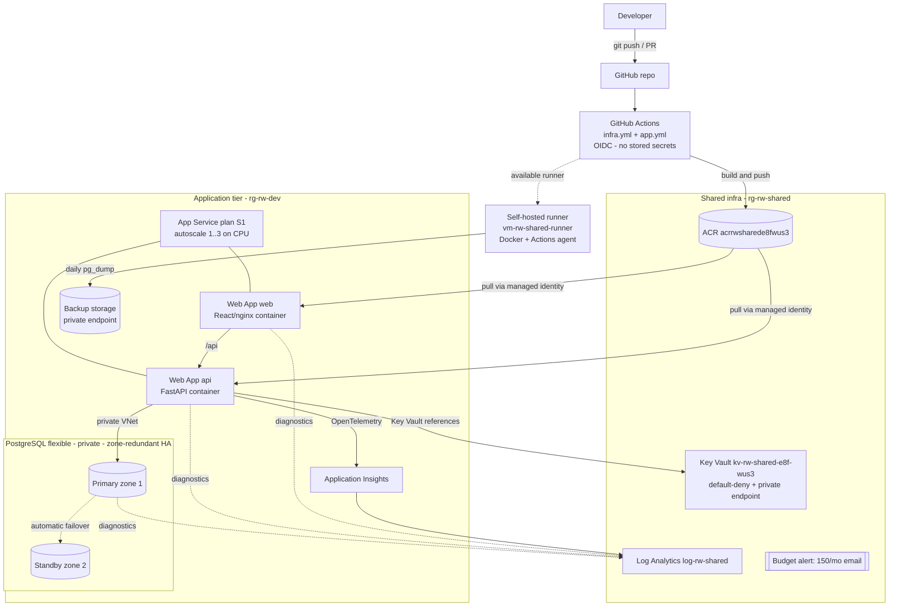
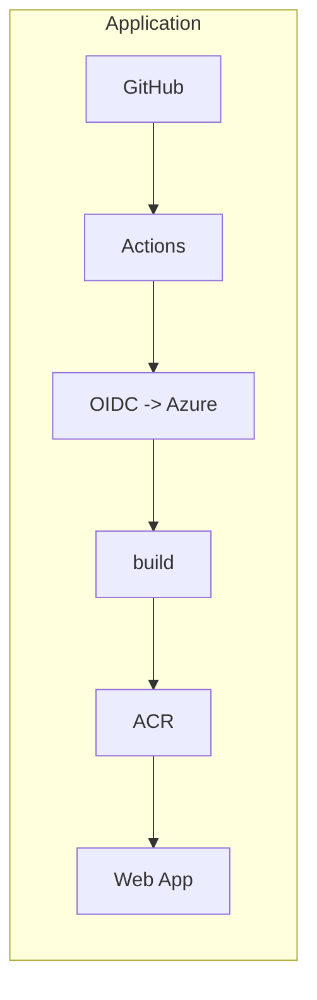
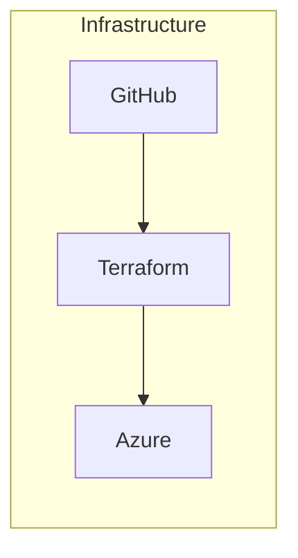
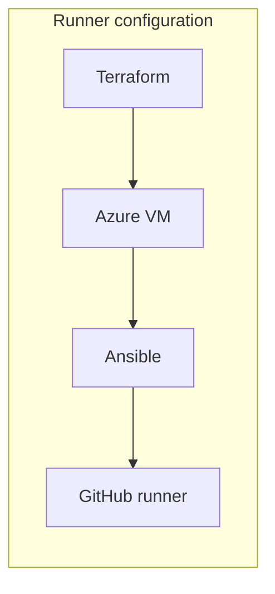

# Architecture

A scalable, secure continuous-delivery platform for a RealWorld application on Azure.
Everything is provisioned as code (Terraform), the CI runner is configured with Ansible, and
build/test/deploy run through GitHub Actions authenticating to Azure with OIDC — no stored cloud
credentials.

Region: **West US 3**.

## Tiers

The application tier lives in a VNet: the web apps use regional VNet integration; PostgreSQL is
private (no public endpoint) with **zone-redundant HA** (hot standby + automatic failover). The
API and web apps each run on their **own App Service plan** so they scale independently — the API
plan also scales on HTTP queue length, not just CPU — each **autoscaling 2→3** so there is never a
single instance. Key Vault and the backup storage are reached through **private endpoints** and are
default-deny to the public internet. The backend emits request and dependency telemetry to
**Application Insights** via the Azure Monitor OpenTelemetry distro.

## Scaling, load balancing & multi-region DR

- **Independent scaling** — `plan-rw-<env>-api` and `plan-rw-<env>-web` are separate plans, each
  with its own `azurerm_monitor_autoscale_setting` (the `autoscale` module). The backend can scale
  out under API load without touching the frontend.
- **Global entry point** — `stacks/frontdoor` puts **Azure Front Door** in front of the app:
  L7 load balancing, TLS termination, a WAF policy (rate limiting + the OWASP managed rule set on
  Premium), health probes per origin, and **health-based failover**. Origins are ordered by region,
  so the primary is priority 1 and a secondary region is a warm standby.
- **Region DR** — the app stack is region-parameterized (`location` + `region_code` +
  `shared_state_key`), so a second region is the same code in another workspace/tfvars
  (`secondary.tfvars.example`). PostgreSQL supports **geo-redundant backups**
  (`postgres_geo_redundant_backup`) and a **cross-region read replica** (`database_role = replica`)
  that is promoted on failover; ACR is **geo-replicated** (Premium) so each region pulls locally.
  The failover procedure is in `docs/runbooks/disaster-recovery.md`.

## Deployment flows

## Environments & state

Terraform is split into reusable `modules/` and `stacks/`:

- `stacks/identity` — GitHub OIDC app registration, federated credentials, RBAC (bootstrap).
- `stacks/shared` — RG, Log Analytics, ACR, Key Vault, VNet + subnets, runner identity.
- `stacks/app` — the application tier; **environment-agnostic**, with dev/staging/prod (and
  per-region) as Terraform **workspaces** + per-env `*.tfvars` (no copied folders).
- `stacks/frontdoor` — the global Front Door entry point; origins point at each region's app tier.
- `runner-infra/` — the self-hosted runner VM (Terraform) and its Ansible configuration, kept
  separate as shared CI/platform infrastructure.

Remote state is in an Azure Storage account using Azure AD auth (no keys); one state key per
stack, workspaces isolate app environments.

## Security

- **GitHub OIDC** federation — passwordless Azure auth from Actions; no cloud secrets in GitHub.
- **Managed identities** — web apps pull from ACR and read Key Vault with their own identity; no
  registry passwords or connection strings in config (Key Vault references).
- **Least-privilege RBAC** — `AcrPull` for app identities, `Key Vault Secrets User` for the API,
  scoped role assignments.
- **Network isolation** — private PostgreSQL, VNet-integrated web apps, NSG on the runner;
  **private endpoints** for Key Vault and backup storage, both default-deny to the public
  internet. Pipelines on GitHub-hosted runners allow-list their egress IP on Key Vault only for
  the duration of a run.
- **Secrets** — DB URL and app secret generated by Terraform and stored only in Key Vault.
- **Resilience** — zone-redundant PostgreSQL HA with automatic failover; CPU autoscale 1→3.
- **Auditing/governance** — diagnostic logs to Log Analytics; a subscription **budget alert**;
  consistent resource tags (`product`, `env`, `managedBy`).

## How this maps to the task requirements

| Requirement | Where |
|-------------|-------|
| App broken into tiers | app / database / registry / runner, above |
| Provisioned via IaC | `infra/terraform` (Terraform) + `runner-infra/ansible` (Ansible) |
| Automated build/test/deploy | `.github/workflows/app.yml` (path-filtered: builds/deploys only the changed app) |
| Catch performance regressions | k6 gate in `app.yml` (`tests/perf/smoke.js`) |
| Daily DB + storage backups | managed PG backups + `scripts/backup` + `backup.yml` |
| Logs off-host, all tiers | diagnostic settings → Log Analytics (`docs/observability.md`) |
| One major cloud | Azure |
| Historical metrics | App Insights (OpenTelemetry) + workbook (`stacks/app/observability.tf`) |
| Runtime start/stop/scale | `scripts/runtime` |
| Scalability | per-app autoscale (API on CPU + HTTP queue, web on CPU), min 2 instances |
| Load balancing | Azure Front Door (global L7 LB + WAF + TLS) + App Service per-plan LB |
| High availability / failover | PostgreSQL zone-redundant HA (hot standby) + min 2 app instances |
| Disaster recovery (region loss) | Front Door failover to a second region, geo-redundant DB backups + cross-region read replica, geo-replicated ACR (`docs/runbooks/disaster-recovery.md`) |
| Cost governance | subscription budget alert (`stacks/shared/governance.tf`) |
| Architecture diagram | this document |
