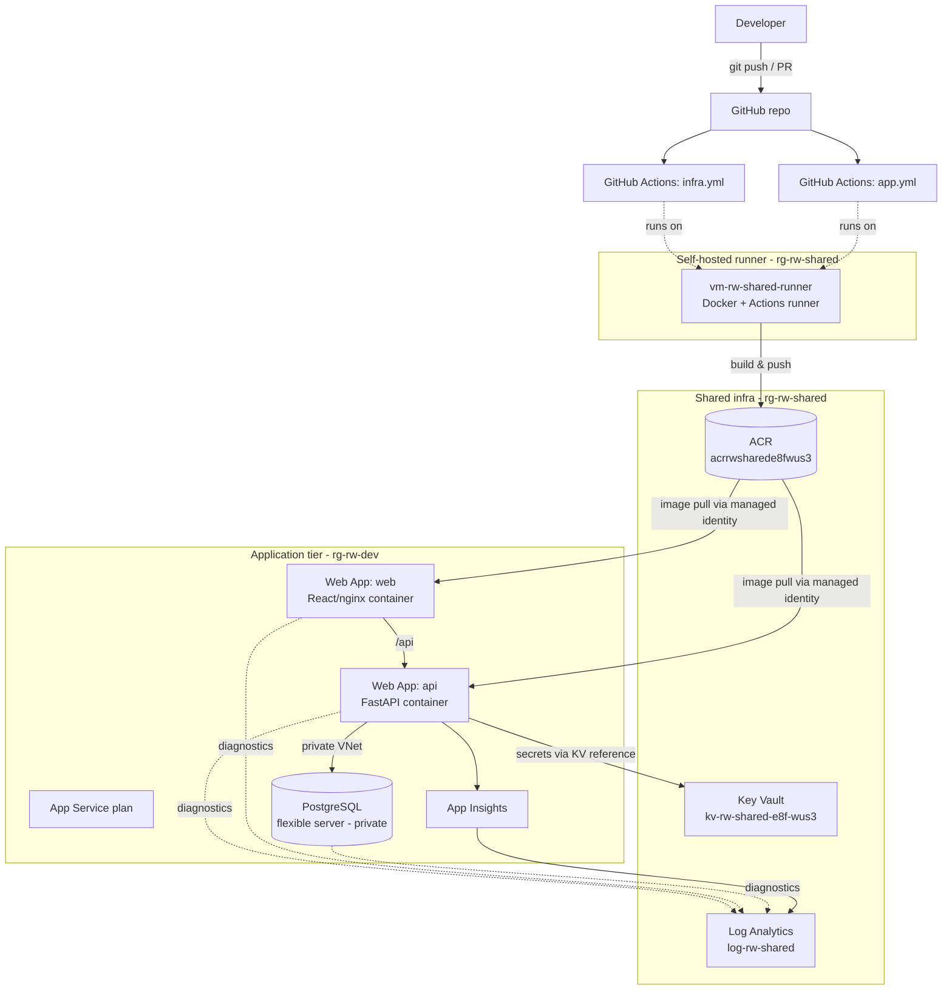
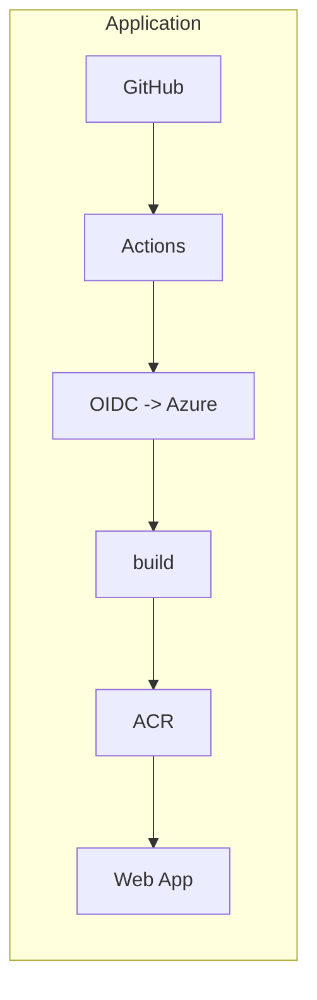
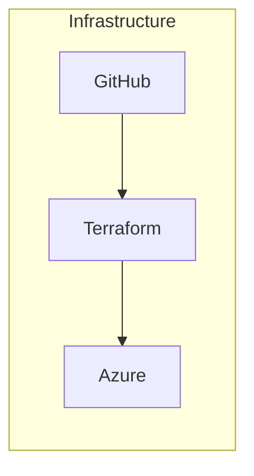
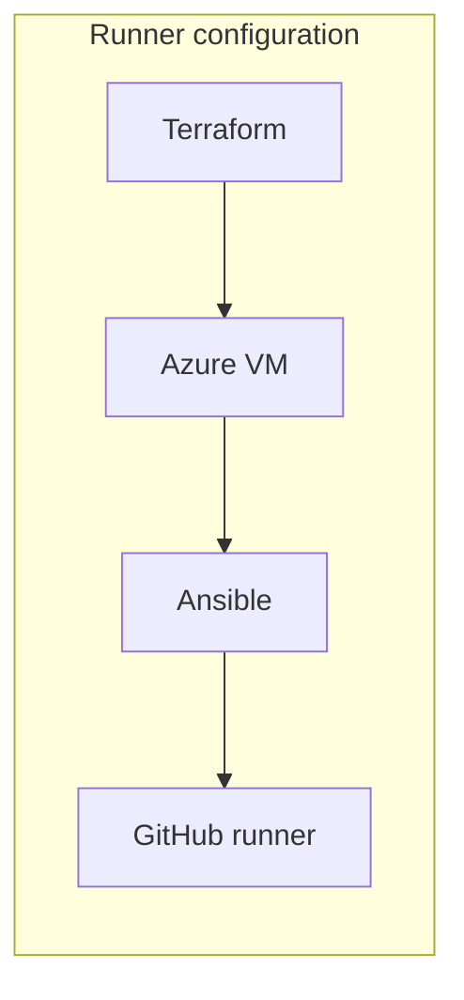

# Architecture

A scalable, secure continuous-delivery platform for a RealWorld application on Azure.
Everything is provisioned as code (Terraform), the CI runner is configured with Ansible, and
build/test/deploy run through GitHub Actions authenticating to Azure with OIDC — no stored cloud
credentials.

## Tiers

The application tier lives in a VNet: the web apps use regional VNet integration, and PostgreSQL
is private (no public endpoint), reachable only from inside the network — including by the
self-hosted runner for migrations and backups.

## Deployment flows

## Environments & state

Terraform is split into reusable `modules/` and `stacks/`:

- `stacks/identity` — GitHub OIDC app registration, federated credentials, RBAC (bootstrap).
- `stacks/shared` — RG, Log Analytics, ACR, Key Vault, VNet + subnets, runner identity.
- `stacks/app` — the application tier; **environment-agnostic**, with dev/staging/prod as
  Terraform **workspaces** + per-env `*.tfvars` (no copied folders).
- `runner-infra/` — the self-hosted runner VM (Terraform) and its Ansible configuration, kept
  separate as shared CI/platform infrastructure.

Remote state is in an Azure Storage account using Azure AD auth (no keys); one state key per
stack, workspaces isolate app environments.

## Security

- **GitHub OIDC** federation — passwordless Azure auth from Actions; no cloud secrets in GitHub.
- **Managed identities** — web apps pull from ACR and read Key Vault with their own identity; no
  registry passwords or connection strings in config (Key Vault references).
- **Least-privilege RBAC** — `AcrPull` for app identities, `Key Vault Secrets User` for the API,
  scoped role assignments.
- **Network isolation** — private PostgreSQL, VNet-integrated web apps, NSG on the runner.
- **Secrets** — DB URL and app secret generated by Terraform and stored only in Key Vault.
- **Auditing/governance** — diagnostic logs to Log Analytics; consistent resource tags
  (`product`, `env`, `managedBy`).

## How this maps to the task requirements

| Requirement | Where |
|-------------|-------|
| App broken into tiers | app / database / registry / runner, above |
| Provisioned via IaC | `infra/terraform` (Terraform) + `runner-infra/ansible` (Ansible) |
| Automated build/test/deploy | `.github/workflows/app.yml` |
| Catch performance regressions | k6 gate in `app.yml` (`tests/perf/smoke.js`) |
| Daily DB + storage backups | managed PG backups + `scripts/backup` + `backup.yml` |
| Logs off-host, all tiers | diagnostic settings → Log Analytics (`docs/observability.md`) |
| One major cloud | Azure |
| Historical metrics | App Insights workbook (`stacks/app/observability.tf`) |
| Runtime start/stop/scale | `scripts/runtime` |
| Architecture diagram | this document |
